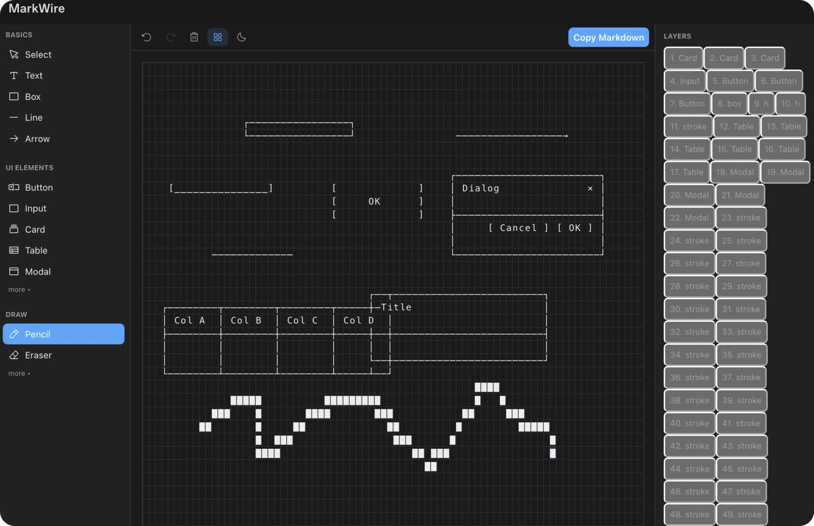

<p align="center">
  
</p>

# markwire

Draw and edit ASCII wireframes inside Codex with a local editor.

MarkWire opens an interactive ASCII wireframe editor for boxes, dividers, labels, UI components, and
layout sketches. Draw on the character grid or ask the model to render a layout from shapes, then copy
the result as Markdown. It is a drawing surface with one output — Markdown — and runs entirely from
the bundled local server.

## Install

```bash
codex plugin marketplace add RetiredPhysicist/openai-plugins
codex plugin add markwire@retiredphysicist
```

Nothing to configure and no remote service. The plugin ships a local stdio MCP server and a
self-contained editor bundle, so it is available in Codex, not ChatGPT.

## Tools

| tool | what it does |
| --- | --- |
| `open_wireframe` | open the editor; pass `shapes` when the layout is known, and a `token` to edit the previous drawing |

The editor supports select, text, box, line, arrow, pencil, eraser, button, input, card, table, modal,
dropdown, toggle, tabs, layers, properties, undo, redo, clear, grid toggle, dark mode, canvas sizes,
and **Copy Markdown**.

MarkWire also registers MCP App entrypoints, so Codex can surface it in the sidebar without a model
call: `thread` opens it as a content tab beside the current conversation, and `global` opens it
fullscreen from the primary sidebar.

## Shape input

Coordinates start at row `0`, column `0`; rows grow downward and columns grow right.

| shape | fields |
| --- | --- |
| box | `row`, `col`, `height`, `width` |
| h / v | `row`, `col`, `length` |
| text | `row`, `col`, `text` |
| stroke | `row`, `col`, `char` |
| cells | `cells: [{ row, col, char }]` |

## Development

```bash
npm install
npm run build
npm test
```

## Credits

An independent implementation inspired by the product idea of
[Mockdown](https://github.com/bbssppllvv/Mockdown). It does not include Mockdown source code.
Toolbar icons are inlined from [Phosphor Icons](https://phosphoricons.com) (MIT).

## License

MIT
